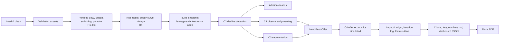

# MetroMart–HSIC Silent Attrition & Share of Wallet: Project Plan (v4, finalised)

> Synchrony Analytics Hackathon 2026. **Required deliverable:** slides as a PDF, emailed to the organisers by **8:00 PM IST, 24 Oct 2026** (the subject line must be the roll number only; do not upload to Google Drive).
> This document is the single source of truth for scope. It covers the planning iterations v1 (core analysis), v2 (USPs and dashboard), v3 (model comparison) and v4 (business value, failure analysis, storyline).

## Contents
1. [Problem & objectives](#1-problem--objectives)
2. [Scope: mandatory vs optional](#2-scope-mandatory-vs-optional)
3. [Storyline & hypotheses](#3-storyline--hypotheses)
4. [Data, definitions & assumptions](#4-data-definitions--assumptions)
5. [Architecture & workflow](#5-architecture--workflow)
6. [Core analyses](#6-core-analyses)
7. [Experiments & evaluation (C1–C4)](#7-experiments--evaluation-c1c4)
8. [Failure analysis & iteration log](#8-failure-analysis--iteration-log)
9. [Business value & impact measurement](#9-business-value--impact-measurement)
10. [USPs](#10-usps)
11. [Visualisations, website & deck](#11-visualisations-website--deck)
12. [Pitfalls & controls](#12-pitfalls--controls)
13. [Implementation phases, dependencies & cut lines](#13-implementation-phases-dependencies--cut-lines)
14. [Verification](#14-verification)
15. [Final deliverables](#15-final-deliverables)

---

## 1. Problem & objectives

MetroMart Inc. and HSIC Bank issue a co-branded credit card.

- **Reward rates at MetroMart:**
  - **Prime members:** 5% on Grocery, 3% on Electronics, 1% on everything else.
  - **Non-Prime members:** 1% on everything.
- **Reward timing:** rewards are credited in the *next* month's statement.
- **Fees:** none.
- **Competition:** no other card matches the Grocery and Electronics rates.

HSIC leadership believes cardholders are moving their MetroMart spend to other payment methods. The two concerns are:
- **silent attrition:** the card stays open but stops being used;
- **declining Share of Wallet (SoW).**

**SoW** = spend on the HSIC card at MetroMart ÷ the cardholder's total spend at MetroMart. It is calculated on **net** sales, only for the period when the card was **active**.

**Objectives (from the brief)**
1. Analyse two years of combined MetroMart and HSIC transaction data.
2. Find insights into silent attrition and declining SoW.
3. Build customer segments, using a model or method, that identify low-SoW customers.
4. Design targeted offers and rewards that increase use of the card at MetroMart.

**What the data already shows (read-only profiling)**

| Signal | Value |
|---|---|
| Portfolio SoW (active-card spend only) | **28.9% in FY25 → 19.5% in FY26**. By quarter: 33.3% (Aug–Sep 2024) down to 14.6% (Jul 2026) |
| Where the HSIC share went | Cash/UPI gained 4.5pp; Debit and Other Bank Credit Card each gained about 2pp; MetroMart Wallet is the largest method overall (about 35%) |
| Reward paradox | HSIC SoW is about 23–24% in **every** category for **both** Prime and Non-Prime. The 5%/3% Prime rates don't pull in any extra spend |
| Explicit attrition | 7,664 cards closed, at a rate rising every quarter (1,196 in Apr–Jun 2026). **6,227 of these customers keep shopping at MetroMart** |
| Zero SoW | About 26% of active cardholders have SoW = 0 |
| Data consistency | 0 HSIC transactions fall outside the active-card window |
| **Sparse data** | About 2.5 transaction rows per customer per 6 months (see §3, Iteration 0) |

---

## 2. Scope: mandatory vs optional

| Layer | Items | Why |
|---|---|---|
| **MANDATORY (case brief)** | **M1** SoW = HSIC net ÷ total net at MetroMart, active window only, fiscal year August–July, returns count as 0 transactions · **M2** insight into silent attrition and declining SoW · **M3** segments from a model or method that identify low-SoW customers · **M4** targeted offers and rewards · **M5** every assumption stated, slides in PDF | Required |
| **CORE CREDIBILITY (our standard)** | Experiments C1–C3 with baselines, time-based validation and failure analysis · noise-adjusted silent attrition (USP #21) · Impact Ledger tagged Measured / Simulated / Assumed | Makes M2–M4 defensible |
| **OPTIONAL INNOVATION** | USPs #1–15 (§10), dashboard, simulators | Each must link back to SoW, attrition, rewards or a decision; they are cut in the order given in §13 |

---

## 3. Storyline & hypotheses

The notebook, the website and the deck all follow one storyline: **Problem → Hypothesis → Experiments → Evidence → Insights → Final Solution → Business Impact**

Every hypothesis below has a decision rule. These rules were **fixed before the analysis**.

| ID | Hypothesis | Test | Evidence metric | Supported if | If rejected |
|---|---|---|---|---|---|
| H1 | The decline is behavioural (customers who stayed moved their spend elsewhere), not a change in who the customers are | SoW Bridge (#1) | Share of ΔSoW from stayers vs leavers and joiners | Stayers explain ≥ 50% | Focus on acquisition and the closure mix |
| H2 | Spend moved to specific methods, not evenly | Switching (#5) | Share gained by each method among stayers | 1–2 methods take ≥ 60% of the shift | Offers are not tied to competitors |
| H3 | Customers don't notice the reward value: Prime members don't use the 5%/3% | Reward paradox (#2) | Prime minus Non-Prime SoW in Grocery and Electronics | Gap ≤ 2pp | Awareness isn't the lever; use economics instead |
| H4 | Silent attrition is real beyond sampling noise, and it comes before closure | #21 null model + #4 decay curve | Observed minus expected zero-HSIC rate; months of SoW decay before closure | Excess > 0 with CI excluding 0; decay starts ≥ 2 months before closure | No silent-attrition programme; target closure only |
| H5 | Closure can be predicted earlier and better than a simple recency rule | **C1** | Top-decile capture and PR-AUC vs rule B1 (paired bootstrap) | CI of the difference excludes 0 | Ship the rule, and say so |
| H6 | A SoW decline can be detected per customer despite sparse data | **C2** | F1 on injected declines; placebo false-positive rate | F1 ≥ 0.6 at k = 50% with false positives ≤ 10% | Report declines only at segment level |
| H7 | Segments differ in how much spend can be recovered, and they need different offers | **C3** | Outcome separation + low-SoW targeting efficiency | Chosen method passes the gates and separates outcomes | Use fewer, broader segments |
| H8 | Offers that only reward spend above a baseline beat blanket rate hikes | **C4** (simulated) | Net value and break-even shift rate for each design | The threshold offer has the lower break-even | Recommend the category-boost design |

**Final solution:** a monthly **HSIC Wallet-Recovery Engine**, made of:
- a noise-aware decline detector;
- an early-warning model chosen through comparison;
- explainable segments;
- a Next-Best-Offer engine with holdouts;
- an Impact Ledger.

---

## 4. Data, definitions & assumptions

### Files (in the repo root; see README for data handling)
| File | Rows | Profile |
|---|---|---|
| `Customer Data.csv` | 45,000 | Customer_ID, Age (18–60), Gender, Membership_Type (26,971 Prime / 18,029 Non-Prime), card open and close dates, Credit_Card_Limit, Credit_Card_APR. **6,836 customers have no card** (open date, limit and APR are null). **7,664 cards are closed.** Open dates run to 2026-08-05, which is after the data ends. No close date falls before its open date. No duplicate IDs. |
| `Transactions Data.csv` | 444,118 | Customer_ID, Transaction_ID, Transaction_Date, Category_Code, Transaction_Type (Sale/Return), Transaction_Amount, Payment_Code, Number_of_Transactions. Dates run **2024-08-01 to 2026-07-31, i.e. FY25 + FY26**. **44,814 rows are Returns, all with a null Number_of_Transactions.** **21,235 rows are capped at ₹9,999.99**, mostly Large Appliances, Furniture, Travel and Electronics. No duplicates and no orphan customers. |
| `Category Code.csv` | 10 | 1 Grocery, 2 Electronics, 3 Apparel, 4 Beauty, 5 Furniture, 6 Kids And Toys, 7 Large Appliances, 8 Outdoor, 9 Travel, 10 Bill Payments |
| `Payment Code.csv` | 5 | 1 Debit Card, 2 Other Bank Credit Card, **3 HSIC Bank Credit Card**, 4 Cash/UPI, 5 MetroMart Wallet |

### Cleaning and definition rules
- `net_amt` = +Amount for a Sale and −Amount for a Return. `n_txn` = 0 for Returns.
- `FY` = calendar year + 1 if the month is August or later (FY25 = Aug 2024–Jul 2025, FY26 = Aug 2025–Jul 2026). Also add `month` and `half` (H1 = Aug–Jan, H2 = Feb–Jul).
- `active` = open date ≤ transaction date ≤ close date. Both ends are inclusive; a null close date means the card is still open.
- `is_hsic` = Payment_Code == 3. `reward_rate` comes from membership × category. `reward_credit_month` = transaction month + 1.
- SoW is always a **ratio of sums**, never an average of per-customer ratios.
- Customer-level SoW is undefined when active net spend ≤ 0 or there are fewer than 2 active Sale rows. Values are clipped to [0, 1] and flagged.

### Assumptions (published in the deck appendix and the Methods tab)
- **Data**
  - Amounts are in ₹.
  - Prime status is a single static snapshot.
  - Bill Payments and Travel bought at MetroMart are "other eligible" purchases at 1%.
  - A Return reduces the payment method recorded on the Return row, and its rewards are clawed back. Returns are not linked to their original sale.
  - The card is active on both its open and close dates.
  - Customers without a card are excluded from SoW and used only as a payment-mix benchmark.
  - `Number_of_Transactions` is the count of purchases within a row and is used only for frequency. `Transaction_Amount` is the row total.
  - Reward history is *derived* (HSIC net × rate, credited the following month).
  - Silent attrition = the card is still open, but HSIC use has stopped or collapsed while the customer keeps shopping at MetroMart.
- **Modelling**
  - Look back 12 months and predict 6 months ahead.
  - A customer can appear in more than one snapshot (time-based testing).
  - The null model holds each customer's historical HSIC share fixed.
  - Synthetic declines are injected only to test detectors, never into reported business numbers.
- **Business (all labelled as assumptions):** interchange %, MetroMart co-funding %, response and save rates, three scenarios (conservative / base / optimistic), and the Prime fee (P2).

### Known limitations
- The ₹9,999.99 cap means spend is understated. This is disclosed, not corrected.
- There is no interchange, funding, offer-response or **redemption** data, so response can only be simulated until a pilot runs.
- Prime status is a snapshot, so any change history is unknown.

---

## 5. Architecture & workflow

### Repository layout (planned)
```
├── README.md, PROJECT_PLAN.md, TASKS.md
├── sow_analysis.ipynb                # the ONLY analysis code
├── outputs/
│   ├── customer_scores.csv           # id, segment(+prob), risk, reasons, NBO, holdout flag, evidence flag
│   ├── segment_summary.csv
│   ├── impact_ledger.csv             # metric, value, type (Measured/Simulated/Assumed), source cell, scenario
│   ├── key_numbers.md                # every number quoted in the deck, generated by code
│   ├── charts/*.png                  # deck charts, 200 dpi, 16:9-friendly
│   └── model_eval/
│       ├── selection_log.md          # selection rules fixed in advance (written BEFORE any model runs)
│       ├── iteration_log.md          # trigger → lesson → change → effect
│       ├── ews_comparison.csv, decline_detection.csv, segmentation_scorecard.csv, offer_design.csv
│       └── failure_atlas.csv         # per experiment: error type, count, slice, example IDs
└── dashboard/
    ├── index.html, app.js            # vanilla JS single-page app
    └── data/*.json                   # written by the notebook; the dashboard only reads these
```

### Stack
- **Python:** Anaconda 3.13 at `C:\Users\asus\anaconda3\python.exe` (the bare `python` on the PATH is the Microsoft Store stub).
  - Libraries: pandas 2.3, numpy 2.3, matplotlib 3.10, scikit-learn 1.7.2, statsmodels 0.14.5, scipy 1.16.3. **Nothing new needs installing.**
  - Not installed and not needed: SHAP, LightGBM, lifelines.
- **Dashboard:** plain HTML + vanilla JS + **ECharts 5.5.0 from cdnjs** (pinned), with no build step. Hosted as a private claude.ai Artifact (multi-file, < 16MB); the owner decides whether to share it.
- **Database:** none. About 22MB of CSV, so flat CSV and JSON are enough.
  - Dashboard JSON: aggregates are < 200KB each. `customers.json` is about 38k rows in columnar form (≈ 3–4MB). `txns.json` holds transactions in columnar form, lazy-loaded for Customer 360, with a target of < 8MB.
  - If the total exceeds 12MB, keep timelines only for the top 5,000 customers by risk/opportunity, plus segment exemplars.
- `SEED = 42` everywhere.

### Analytical workflow


### Notebook sections (run in this order)
| § | Content |
|---|---|
| 0 | Config: paths, thresholds, `ASSUMPTIONS`, `SEED`, snapshot cutoffs; **write `selection_log.md` first** |
| 1 | Load, clean, enrich |
| 2 | Validation asserts (+ threshold sensitivity table → #20) |
| 3 | Portfolio SoW (M1): by month and FY, category × membership, cohort, age, limit and APR bands |
| 4 | SoW Bridge (H1) |
| 5 | Switching (H2) |
| 6 | Reward paradox + missed cashback (H3) |
| 7 | #21 null model + #4 pre-closure decay curve + #12 vintage curves (H4) |
| 8 | `build_snapshot` + leakage asserts |
| 9 | **C2** decline detection + failure analysis |
| 10 | Attrition classes using the C2 winner (M2) |
| 11 | **C1** closure early-warning + failure analysis |
| 12 | **C3** segmentation + failure analysis (M3) |
| 13 | Next-Best-Offer engine (M4) |
| 14 | **C4** offer economics + sensitivity |
| 15 | #13 big-ticket gap, #14 seasonality, minimum-detectable-effect (MDE) baselines |
| 16 | Impact Ledger |
| 17 | Iteration log + Failure Atlas exports |
| 18 | Charts, `key_numbers.md`, dashboard JSON |

C2 runs before C1 and C3 because its winning detector defines the "decline" features they use.

### Production blueprint (one slide, conceptual only)
1. The warehouse holds `fact_txn`, `dim_customer`, `dim_category` and `dim_payment`.
2. A monthly batch (SQL or PySpark, same logic as the notebook) writes `customer_scores` and `campaign_assignments` (with a holdout flag).
3. Those feed the CRM or campaign tool (app push, SMS, statement message).
4. Responses land in `campaign_outcomes`, which is used for measurement and quarterly retraining.
5. Monitoring tracks PSI drift, calibration and campaign lift.

---

## 6. Core analyses

| Analysis | Method |
|---|---|
| **Portfolio SoW (M1)** | Monthly and FY trend from active-card rows only, with FY boundary markers. Payment-method mix by FY. Heatmap of category × membership. SoW by card-open cohort, age band, credit-limit band and APR band. |
| **SoW Bridge (#1, H1)** | An exact, additive breakdown, asserted to reconcile: **FY25 SoW** → *leaver effect* = SoW(stayers, FY25) − SoW(all, FY25) → *stayer behaviour*, split into the share change of each destination method (Debit, Other CC, Cash/UPI, Wallet; together they equal −ΔHSIC share) → *joiner effect* = SoW(all, FY26) − SoW(stayers, FY26) → **FY26 SoW**. |
| **Switching (#5, H2)** | Each customer's dominant payment method per FY (by net spend). A FY25 → FY26 transition matrix for stayers, drawn as a Sankey. Journey timing: the month of the last HSIC transaction and the next method used. |
| **Reward paradox / missed cashback (#2, H3)** | Non-HSIC active spend × the customer's own reward rate = "₹ left on the table", rolled up by segment, Prime status and category. P2 (#16): the extra cashback Non-Prime customers would get as Prime. |
| **Noise-adjusted silent attrition (#21, H4)** | Expected chance of zero HSIC in the next 6 months = (1 − historical HSIC row share)^(future rows), compared with what is observed, at three cutoffs, with a bootstrap CI on the excess. |
| **Pre-closure decay curve (#4, H4)** | Line up the 7,664 closures on their closing month. Plot HSIC share from month −12 to 0 against the portfolio's SoW in the same calendar months. Also include spend after closure. |
| **Onboarding cliff (#12)** | SoW by months since opening, for cards opened inside the data window. |
| **Attrition classes (M2)** | Applied in this order: **Explicit** (closed inside the window; size the spend after closure and the reward credit forfeited) → **Silent** (card open, HSIC used before, zero HSIC net in the last 6 months while still shopping, *and statistically surprising under the null model*) → **Decliner** (flagged by the C2 winner) → **Never-activated** (card open, no HSIC spend ever, still shopping) → **Stable / Grower** → **Insufficient evidence** (below the minimum-evidence rule). Sensitivity: 6 vs 9 months, 10 vs 15pp. |
| **Next-Best-Offer (#7, M4)** | An offer library: win-back reopen boost; instant-credit reactivation; category boost on the customer's top leaking category; tier bonus on spend above their baseline; streak bonus; 0% EMI on big-ticket purchases (#13); and **no incentive for Loyal core** (a free "₹ left on the table" message only). Per customer: choose the eligible offer with the best expected net value = incremental HSIC spend × margin − incremental reward cost. Output the offer, expected uplift, cost, ROI flag, holdout flag (10% per segment, seeded) and evidence flag. |
| **Big-ticket financing gap (#13)** | HSIC share of Large Appliances, Furniture and Electronics spend vs other methods, which motivates a 0% EMI offer. Flags the cap. |
| **Seasonality (#14)** | Net spend and SoW by month × segment, which produces the campaign calendar. |
| **Simulator baselines (#8–10)** | Per segment: baseline spend by method and category, variance of SoW, reward base. Revenue at risk = HSIC spend lost FY25 → FY26 × interchange % (an assumption). |

### Simulator logic (`app.js`, recomputed live)
- **#9 SoW simulator.** For segment *p*, moving xₘ% of each non-HSIC method's spend to HSIC gives SoW′ = (H + Σ xₘ·Sₘ) / T. Outputs: SoW, incremental HSIC ₹, and reward cost at the segment's average rate.
- **#8 Reward what-if.**
  - Inputs: cashback rate by tier × category, response elasticity, interchange % and co-funding %.
  - Outputs: incremental spend; reward cost split into **cost on incremental spend** vs **cannibalised cost** (rewards paid on spend that would have happened anyway); net value; break-even response.
- **#10 Campaign planner.**
  - Inputs: segment, holdout %, expected uplift.
  - Outputs: treated and control counts; MDE at 80% power and α = 0.05 using the segment's *real* SoW standard deviation; cost and ROI.

---

## 7. Experiments & evaluation (C1–C4)

### Shared protocol
- **Time-based splits, never random.** Every experiment uses `build_snapshot(cutoff, lookback=12m, horizon=6m)`, which returns features from data ≤ the cutoff and labels from (cutoff, cutoff + 6m].
  - *Train / tune:* the **2025-07-31** snapshot (labels Aug 2025–Jan 2026), with 5-fold StratifiedGroupKFold inside it.
  - *Test once:* the **2026-01-31** snapshot (labels Feb–Jul 2026).
  - *Deploy:* retrain on both snapshots, then score at **2026-07-31**. These scores are predictions, labelled as such.
- **Leakage controls:**
  - Assert max feature date ≤ cutoff < min label date.
  - The close date is used only for the label and for eligibility.
  - Tenure is measured at the cutoff.
  - Scalers and imputers live inside sklearn Pipelines.
  - Segment labels are never used as features.
  - **Gender is never a model feature**; it is used only in the fairness check.
  - Prime and age are static fields, used with a caveat.
- **Selection rules are fixed in advance** and logged in `selection_log.md` before any model runs. The winner is chosen on validation and confirmed once on test, with no re-tuning afterwards.
- **Uncertainty:** 1,000 bootstrap resamples on test. A method counts as "better" only if the CI of its *paired* difference against the baseline excludes 0.
- **Explanations are required:** global drivers plus customer-level reason codes, or a faithful rule explanation.

### C1: Closure early-warning (H5 → USP #3)
- **Target:** the card closes within 6 months.
  - Base rate 4.1% on train and 4.5% on test (≈ 650 and 870 positives).
  - Universe: card open at the cutoff, tenure ≥ 6 months, HSIC used before the cutoff.
- **Features:**
  - **Recency:** months since the last HSIC transaction and since the last MetroMart transaction.
  - **HSIC share:** last 6 months vs the 6 months before, *shrunk* with the C2 method.
  - **Spend and activity:** HSIC row count; log total net spend; Cash/UPI, Wallet, Debit and Other CC shares over the last 6 months; Grocery + Electronics share; return rate.
  - **Profile:** tenure, Prime, age, limit, APR.
  - **Missed cashback** over the last 6 months.

| Method | Why it fits | Trade-off |
|---|---|---|
| B0 Prevalence / random | Floor (PR-AUC = base rate) | — |
| **B1 Recency rule** (months since last HSIC use, + v1 attrition class) | What a bank would do without a model; the bar to clear | Ignores everything else |
| **M1 L2 logistic regression** (standardised) | Odds ratios and exact reason codes; works well with few positives | Linear |
| **M2 HistGradientBoosting** (small grid: depth, learning rate, l2) | Tests whether non-linear effects and interactions add anything | Less transparent; can overfit ~650 positives |
| M3 Random Forest (balanced subsample) — P1 | A second non-linear model, to check whether M2's gains are real | Poorly calibrated |
| M4 Cox proportional hazards (statsmodels `PHReg`) — P1 | Uses *when* customers close, with proper censoring | Proportional-hazards assumption (checked with Schoenfeld residuals) |

- **Metrics:**
  - *Main:* **PR-AUC**, because positives are rare.
  - *Business:* **top-decile capture and lift**; contacts needed per closer reached; expected campaign value at top-k.
  - *Also:* ROC-AUC, Brier score, calibration curve, C-index, and stability of the top decile across folds.
- **Class imbalance:** use PR-AUC and lift, never accuracy. Classes are weighted, not resampled. Isotonic calibration is used if the winner isn't LR.
- **Selection rule:** among models within 1 SE of the best validation PR-AUC, take the most interpretable (LR > Cox > HGB > RF). It must beat B1 on top-decile capture with a CI that excludes 0; **otherwise ship B1 and say so**.
- **Explanations:**
  - LR odds ratios with 95% CIs (statsmodels `Logit`).
  - Permutation importance for every model, side by side.
  - Partial dependence for the top 3 features.
  - Reason codes = the top 3 contributions of coefficient × (value − mean), or from an LR surrogate with its fidelity reported.

### C2: Customer-level decline detection (H6)
The goal is to separate a *true* fall in HSIC share from sampling noise. Test compares FY25 with H1 FY26; deployment compares FY25 with FY26.

| Method | Why it fits | Trade-off |
|---|---|---|
| **D0 Naive ΔSoW** (≥ 10pp *and* ≥ 30% relative) | Baseline: what most teams do | Very noisy at about 5 rows per period |
| **D1 Empirical-Bayes beta-binomial shrinkage** (prior fitted by method of moments; flag if the shrunk drop is ≥ 10pp) | Transparent and cheap; small samples are pulled toward the mean | Works on row counts, so ₹ is only approximated |
| **D2 Bayesian posterior** P(FY26 share < FY25 share − 5pp) ≥ 0.8 (Beta posteriors, 2,000 Monte Carlo draws) | Gives an actual probability of decline | The threshold is a choice |
| **D3 Fisher exact test + Benjamini–Hochberg FDR** | A classical test with false-discovery control | Very little power with sparse data |

- **Evaluation** (there is no ground truth, so three tests):
  1. **Semi-synthetic recovery (main):** inject k = 25/50/75/100% switches of HSIC rows to the customer's other main method, into stable customers. Measure precision, recall and F1 at each k, plus the false-positive rate on untouched customers.
  2. **Placebo:** shuffle period labels within each customer. Anything flagged is a false positive.
  3. **Predictive validity:** future closure and HSIC share for flagged vs unflagged customers (lift with bootstrap CI).
- **Selection rule:** the best mean F1 at k = 50 and 75, with placebo false positives ≤ 10%. Ties go to the more explainable method (D1 > D2 > D3).

### C3: Segmentation (H7, M3 → USP #6)
- **Feature space** (the same for every method): shrunk SoW level, ΔSoW, log of MetroMart net spend, months since last HSIC use, Grocery + Electronics share, Cash/UPI share, Wallet share, Prime, missed cashback. Features are standardised; spend is winsorised at p1/p99.

| Method | Why it fits | Trade-off |
|---|---|---|
| **S0 SoW-quartile baseline** | The simplest way to find low-SoW customers | Ignores value, trend and destination method |
| **S1 Rule-based personas** (first match wins) | Maps to offers by construction; fully explainable | Thresholds set by hand |
| **S2 K-means** (k = 3–8 by silhouette and elbow; 20 starts) | Finds structure in the data | Hard, spherical clusters |
| **S3 Gaussian Mixture** (full covariance, k by BIC) | Soft membership probabilities | Less stable |
| *Explainer* — a depth-3 decision tree trained on S2/S3 labels | Its fidelity measures how explainable the clusters are; its splits can re-tune S1 | — |

**S1 personas (starting rules):**

| Persona | Rule | Lever |
|---|---|---|
| Closed but still shopping | Explicit attriter with MetroMart spend after closure | Win-back: reopen + first-90-day boost |
| Dormant cardholder | Silent attriter or never-activated | Instant-credit reactivation |
| Prime under-user | Prime, SoW < 20%, Grocery + Electronics spend on other methods ≥ median | Make 5%/3% visible + category boost |
| High-value split wallet | Top-tercile MetroMart spend, SoW < 20% | Bonus tier above baseline |
| Fading loyalist | Decliner with FY25 SoW ≥ 30% | Retention nudge + streak bonus |
| Loyal core | SoW ≥ 50% and stable | **No incentive** (avoid subsidising) |

- **Evaluation:** segments are built at 2026-01-31 and scored on outcomes from Feb–Jul 2026.
  - **Gates:** bootstrap stability ARI ≥ 0.7 (20 resamples); every segment is 3–50% of customers; explanation fidelity ≥ 85%.
  - **Ranked criteria:**
    1. Outcome separation: variance in future HSIC net spend and in closure explained by segment, with CI.
    2. Low-SoW targeting efficiency.
    3. Actionability: the number of distinct offers mapped.
    4. Silhouette, Davies–Bouldin and Calinski–Harabasz, computed for *every* method's labels.
- **Selection rule:**
  - If S1 is within the CI of the best method on outcome separation, **S1 wins**.
  - Otherwise use a **hybrid**: S1 thresholds re-tuned to the explainer tree's splits ("rules calibrated by clustering").

### C4: Offer-design economics (H8 → USP #8) — **simulated, labelled as such**
| Design | Description |
|---|---|
| O0 | Do nothing (baseline) |
| O1 | Blanket +1pp cashback |
| O2 | Category boost on the customer's top leaking category |
| O3 | Bonus only on spend above the customer's baseline (threshold) |
| O4 | Instant-credit reactivation (Dormant customers) |

- **Inputs:** real baseline spend by segment, method and category. Assumed: response (3 scenarios), interchange % and co-funding %.
- **Metrics:** incremental HSIC spend; reward cost split into incremental vs cannibalised; net value; ROI; **break-even shift rate**, which needs no assumption about response.

---

## 8. Failure analysis & iteration log

### Template (every experiment uses it)
- **(a)** Error taxonomy, with counts.
- **(b)** Profiles of correct vs incorrect cases (standardised mean differences).
- **(c)** Metrics by slice: tenure, activity level, Prime, age band, spend tercile, segment, plus a **gender fairness check**.
- **(d)** 3 worked customer examples per error type, with their raw rows.
- **(e)** A "where it breaks" statement.
- **(f)** The iteration it triggers.
- **(g)** **What the failure taught us that the aggregate metric could not.**

| Experiment | Failure analysis |
|---|---|
| **C1** | **Error types:** **FN-sudden** (stable HSIC use until closure) · **FN-sparse** (≤ 3 rows in the lookback) · **FN-new** (tenure 6–9 months) · **FP-silent** (flagged high-risk and didn't close, but HSIC collapsed: a *useful* false positive) · **FP-noise** (nothing changed).<br>**Also:** calibration by slice; feature drift between snapshots (PSI); profile of FN-sudden vs caught closers.<br>**Lesson:** how much closure risk is invisible in transaction data, which is the ceiling an AUC hides. |
| **C2** | **Recall by activity level** shows the smallest decline that can be detected at each amount of data. Profile of placebo false positives (large returns, capped purchases, single big-ticket rows). Cases where row-based and ₹-based measures disagree.<br>**Output:** a published **minimum-evidence rule**.<br>**Lesson:** below N rows, a customer-level "decline" flag is misleading. |
| **C3** | **Contradictions** (e.g. Loyal core who closed; Dormant who came back unprompted). **Boundary sensitivity:** % of customers who change segment at ±5pp thresholds. **Segment purity** on future outcomes. Whether clusters just reproduce spend levels.<br>**Lesson:** which segments are stable enough to fund a campaign. |
| **C4** | **Where ROI turns negative** (tornado sensitivity chart). Segments that are never profitable to target. Explicit statement: *simulations only — just the pilot can measure the real effect.* |

### Iteration log (`outputs/model_eval/iteration_log.md`)
Iteration 0 has already happened. The other rows are **planned triggers**: they run only if that failure actually shows up, and their results are never invented in advance.

| Iteration | Trigger | Lesson | Change |
|---|---|---|---|
| **0 → 1 (observed)** | The naive label "zero HSIC in 6 months" is **62.7% observed vs 43.5% expected by chance** at the 2026-01-31 cutoff (2025-01-31: 47.6% vs 25.8%; 2025-07-31: 54.1% vs 36.0%) | With about 2.5 rows per 6 months, that label is mostly noise. The naive measure overstates silent attrition about 3× | Closure becomes the supervised target; decline detection becomes a statistical problem (C2); #21 added |
| 1 → 2 (C1) | Missed closers are mostly sudden or sparse | Some closures can't be predicted from transactions | Add an abstain / insufficient-evidence tier; the claim becomes "predictable closures" |
| 1 → 2 (C2) | Detectors fail at ≤ 3 rows per period | There is a minimum amount of evidence needed | Minimum-evidence rule: report "insufficient data" instead of a flag |
| 1 → 2 (C3) | More than 15% of customers change segment at ±5pp thresholds | Hard cut-offs are fragile | Use C2 posterior probabilities for membership + a buffer zone; customers on the boundary get the cheaper offer |
| 1 → 2 (C4) | ROI turns negative under realistic cannibalisation | Blanket offers subsidise spend that would have happened anyway | Threshold-only mechanics; Loyal core excluded |
| Any | Feature drift PSI > 0.2 or calibration error > 2pp | The model is going stale | Recalibrate on the latest snapshot; monitor |

---

## 9. Business value & impact measurement

### Users
| User | Need | Output | How often |
|---|---|---|---|
| HSIC co-brand portfolio / customer-value management team | Stop the SoW decline; run the programme | At-risk list, segments, NBO file with holdouts | Monthly |
| Campaign operations | Send the right offer through the right channel | `campaign_assignments` (ID, offer, message, holdout) | Monthly |
| MetroMart partnership team | Decide joint funding and the Prime bundle | Reward economics, category leakage | Quarterly |
| Leadership | Decide where the money goes | Exec story, Impact Ledger | Quarterly |
| Model risk / governance | Trust and monitoring | Model Lab, Failure Atlas, drift and calibration | Quarterly |

### Impact Ledger (`impact_ledger.csv`): every number is tagged
| Type | Metric | Computation |
|---|---|---|
| **Measured** | HSIC spend lost FY25 → FY26; SoW pp lost | Real data, active windows |
| **Measured** | MetroMart spend after closure that HSIC lost | Closed customers' transactions after their close date |
| **Measured** | Missed cashback ("₹ left on the table") | Non-HSIC spend × the customer's rate |
| **Measured (out-of-time)** | Targeting efficiency: % of closers in the top decile; contacts per closer reached vs random | C1 test snapshot |
| **Measured (semi-synthetic)** | Detection precision and recall | C2 |
| **Simulated** | Recovered HSIC spend and SoW +pp (conservative / base / optimistic) | Baseline × shift rate per segment |
| **Simulated** | Campaign net value and ROI; retention (closers saved = captured × save rate) | C4 + assumptions |
| **Assumed** | Interchange %, co-funding %, response rate, save rate | `ASSUMPTIONS`; sliders on the dashboard |
| **Assumption-free** | **Break-even shift rate** (the uplift needed for ROI ≥ 0) | Costs ÷ value per ₹ shifted |

Headline claims use this form: *"₹X lost (measured). Recovering Y% pays for the programme (break-even). Base-case scenario: ₹Z (simulated, with the assumptions listed)."* We **never** say "we will recover ₹Z".

**Pilot design (turns simulated numbers into measured ones)**
- A 10% randomised holdout per segment.
- MDE calculated from the real SoW variance.
- Read-out after 3 months on SoW, HSIC active rate, closure rate and net value.
- **Scale up only if** the CI of the lift excludes 0 and ROI > 0.

### Scalability, privacy, integration, constraints
- **Scalability:** aggregations run in linear time and the models are light. The same logic carries over to SQL or Spark for millions of customers. The dashboard JSON is for the demo only; production would use the bank's BI tool.
- **Privacy:** the data is synthetic, and the dashboard shows customer IDs only. In production:
  - masked IDs and role-based access;
  - data minimisation and purpose limitation in line with India's DPDP Act 2023;
  - marketing-consent checks;
  - Gender kept out of the models, with a fairness check of error rates by gender and age band.
- **Integration:** the outputs are flat tables that mirror the production tables.
- **Constraints:**
  - No interchange, funding, response or redemption data.
  - The ₹9,999.99 cap.
  - Prime status is a snapshot.

### When NOT to use it
- Tenure under 6 months, or fewer than N rows: abstain and report "insufficient evidence".
- Credit or underwriting decisions: this is not a credit-risk model.
- Spend outside MetroMart.
- After a change to the reward structure, until the model is retrained.
- Causal claims about individual customers.
- Customers whose Prime status has changed.

---

## 10. USPs

### Prioritisation matrix
Columns:
- **Impact** — judge wow + business value, 1–5.
- **Feas.** — how feasible within the hackathon timeline, 1–5.
- **Data** — R = real data, H = real baseline + labelled assumptions, S = simulation.
- **P** — P0 = must, P1 = build if on schedule, P2 = stretch, ✗ = cut.

| # | USP | Business thread | Impact | Feas. | Data | Effort | P |
|---|---|---|---|---|---|---|---|
| 1 | SoW Bridge | H1: why SoW fell → fund the right fix | 5 | 5 | R | 1.5h | P0 |
| 2 | Reward paradox + ₹ left on the table | H3: awareness gap → personalised message | 5 | 5 | R | 1h | P0 |
| 3 | Early-Warning Score (C1 winner) | H5: retention money goes to likely closers | 5 | 4 | R | 3h | P0 |
| 4 | Pre-closure decay curve | H4: silent attrition comes first → the window to step in | 5 | 5 | R | 1h | P0 |
| 5 | Payment-switching Sankey + journey | H2: which competitor won each customer | 4 | 5 | R | 1h | P0 |
| 6 | Explainable segments (C3 winner) | H7: segments the business can act on | 4 | 4 | R | 2h | P0 |
| 7 | Next-Best-Offer engine | Turns insight into a campaign file | 5 | 4 | H | 2h | P0 |
| 8 | Reward economics what-if (cannibalisation, break-even, revenue at risk) | H8: stops blanket rate hikes | 5 | 4 | H | 2h | P1 |
| 9 | SoW simulator | Which lever moves SoW the most | 4 | 5 | H | 1.5h | P1 |
| 10 | Campaign test design + ROI (MDE from real variance) | Makes the recommendation measurable | 4 | 5 | H | 1h | P1 |
| 11 | Customer 360 | Shows targeting at the level of one customer | 5 | 3 | R | 3h | P1 |
| 12 | Onboarding cliff (vintage curves) | When new cardholders drop off → onboarding programme | 4 | 5 | R | 0.5h | P0 |
| 13 | Big-ticket financing gap (0% EMI) | Uses the card's financing feature | 4 | 5 | R | 0.5h | P1 |
| 14 | Campaign timing calendar | When to launch each offer | 3 | 5 | R | 0.5h | P1 |
| 15 | Executive story dashboard | Delivers the story; memorable | 5 | 3 | R+H | 4h | P1 |
| 20 | Data trust panel | Credibility | 3 | 5 | R | 0.5h | P0 |
| 21 | Noise-adjusted silent attrition | H4: avoids over-reacting to noise (the naive figure is about 3× too high) | 5 | 5 | R | 0.5h | P0 |
| 22 | Model Lab | Proves the chosen methods are better | 5 | 4 | R | in §7 | P0 |
| 23 | Failure Atlas | Where *not* to trust the outputs; drives the iterations | — | — | R | in §8 | P0 |
| 24 | Impact Ledger | Business claims that hold up to scrutiny | — | — | Mixed, labelled | in §9 | P0 |
| 25 | Operating playbook | How the work fits real banking operations | — | — | Conceptual | 1 slide | P0 |
| 16 | Prime + card bundle economics | Joint MetroMart–HSIC growth lever | 3 | 5 | H (the Prime fee is unknown) | 0.5h | P2 |
| 17 | Non-cardholder acquisition lookalikes | Growth beyond retention | 3 | 5 | H | 0.5h | P2 |
| 18 | Revenue at risk (folded into #8) | Expresses the problem in ₹ revenue | 4 | 5 | H | 0.5h | P1 |
| 19 | Reward-credit timing study | Supports instant cashback vs wallet/UPI immediacy | 3 | 3 | R (may be null) | 1.5h | P2 |
| ✗ | AI chatbot, maps, real-time streaming, deep-learning CLV, redemption analysis | No supporting data (no geography, balances or redemption events), or a gimmick | — | — | — | — | Cut |

### Selected USP details (P0 + P1)
| # | Purpose | Implementation | Data | Dependencies |
|---|---|---|---|---|
| 1 | Explain the 28.9% → 19.5% fall | Exact additive bridge (§6) + waterfall chart | Real | Active-window flags |
| 2 | Show that Prime members ignore their rates; build a personal message | Category × membership heatmap; non-HSIC spend × the customer's rate | Real | Reward-rate mapping |
| 3 | Rank customers by closure risk with reasons | C1 comparison; the winner is retrained and scores customers at 2026-07-31 | Real | `build_snapshot`, C2 features |
| 4 | Show the window to step in before closure | Closures aligned on their close month vs the portfolio baseline | Real | Close dates |
| 5 | Name where the spend went | Dominant-method transition matrix → ECharts Sankey; switch timing | Real | Bridge stayer set |
| 6 | Explainable low-SoW segments | C3 comparison, with reasons per customer | Real | C2 shrinkage |
| 7 | A campaign-ready offer per customer | Offer library + best expected net value + holdout | Real + assumptions | #3, #6, `ASSUMPTIONS` |
| 8 | Avoid paying for spend we'd get anyway | C4 + live what-if sliders | Simulated on a real baseline | Segment baselines |
| 9 | Show which lever moves SoW the most | SoW′ = (H + Σ xₘ·Sₘ) / T, per segment | Simulated on a real baseline | Segment baselines |
| 10 | Make the recommendation measurable | MDE from real SoW standard deviation; holdout sizing; ROI | Real variance + assumptions | #6 |
| 11 | Targeting at the level of one customer | Search by ID: profile, monthly spend by method, SoW line, derived rewards (earned vs credited), risk + reasons, offer | Real | #3, #6, #7 |
| 12 | Shape an onboarding programme | SoW by months since opening | Real | Open dates |
| 13 | Use the card's financing feature | HSIC share of big-ticket categories; cap flagged | Real | Category mapping |
| 14 | Campaign timing | Monthly seasonality × segment | Real | #6 |
| 15 | Tie the whole story together | 10-tab dashboard (§11) | Real + simulated | All exports |
| 20–25 | Trust, proof, failure insight, impact, operations | §7–§9 | Real / labelled | Experiments |

---

## 11. Visualisations, website & deck

### Charts (each tied to a hypothesis)
1. **H1:** SoW trend with FY bands; Bridge waterfall.
2. **H2:** Sankey; shift in method shares.
3. **H3:** Category × Membership heatmap; missed cashback by segment.
4. **H4:** observed vs null zero-HSIC rate; pre-closure decay curve; vintage curves.
5. **C1:** PR and gain curves (B1 dashed); **forest plot of paired differences against B1**; calibration; permutation-importance dot matrix; error-type bars + slice heatmap.
6. **C2:** F1 vs injected decline size; placebo false-positive bars; recall by activity level.
7. **C3:** scorecard heatmap; explainer tree; boundary-sensitivity bars; segment contradiction rates.
8. **C4:** net value by design; tornado sensitivity; break-even shift rate.
9. **Impact:** ledger table with Measured / Simulated / Assumed badges; scenario range bar.
10. **Story:** iteration timeline (0 → 1 → 2).

### Website (P1)
Each tab follows the storyline. Load the `artifact-design` and `dataviz` skills before building.

| Tab | Content |
|---|---|
| 1 Story | Problem → H1–H8 status chips (supported / rejected / partly) → evidence links → solution → impact; KPI tiles |
| 2 Why SoW fell | Bridge, trend, paradox heatmap (H1–H3) |
| 3 Attrition | Decay curve, vintage, attrition classes, #21 (H4) |
| 4 Early warning | C1 winner: risk tiers, reliability diagram, reason codes, sortable at-risk list |
| 5 Segments & offers | C3 winner, NBO, calendar |
| 6 Model Lab | C1–C4 comparisons with a model toggle, Failure Atlas, iteration log |
| 7 Customer 360 | Single-customer view (#11) |
| 8 Simulators | SoW, reward what-if, campaign planner — **every output has a "Simulated" badge** |
| 9 Impact & Operations | Ledger, pilot design, users / run-book diagram, when not to use |
| 10 Methods & trust | Definitions, assumption ledger, validation, threshold sensitivity |

**Design:** HSIC is the hero colour throughout. Supports light and dark themes and is usable on mobile.

### Deck (about 18 slides + appendix; assembled by hand from `outputs/`, exported to PDF)
| Arc | Slides |
|---|---|
| Problem | 1 Title · 2 Exec summary (3 findings, 3 actions, measured loss + break-even + simulated range) · 3 Data, definitions, assumptions |
| Hypotheses | 4 H1–H8 on one slide |
| Experiments & evidence | 5 Bridge (H1) · 6 Where the wallet went (H2) · 7 Reward paradox (H3) · 8 Silent attrition is real but about ⅓ of what it looks like + decay curve (H4) · 9 How we tested (protocol, leakage controls) · 10 C1: why our model beats the rule (forest plot) · 11 C2 + C3 comparison |
| Insights from failure | 12 Failure Atlas: what it taught us that AUC couldn't · 13 Iteration timeline; approaches rejected and why |
| Final solution | 14 Segments → NBO (with the "do not target" rule) · 15 Offer economics: threshold vs blanket |
| Business impact | 16 Impact Ledger + pilot design · 17 Operating playbook (users, monthly run, monitoring, when not to use, privacy) · 18 Decisions asked of HSIC + dashboard link and screenshots |
| Appendix | Full metric tables, slice metrics, selection log, sensitivity, limitations, assumption ledger |

The PDF must stand on its own. The dashboard is a bonus: it gets a link and screenshots in the deck.

---

## 12. Pitfalls & controls
| Pitfall | Control |
|---|---|
| Sparse-data noise | C2 detector + minimum-evidence abstention; portfolio ratio-of-sums for headline numbers |
| Leakage | `build_snapshot` + date asserts + preprocessing inside Pipelines |
| Class imbalance / few positives | PR-AUC and lift; class weights; small parameter grid; CIs |
| Picking the winner after seeing results | Selection log written first |
| Cluster metrics favour clustering methods | Outcome separation on future data is the main criterion |
| Simulations presented as facts | Ledger badges on every number |
| Survivorship (closed cards drop out of FY26 SoW) | Explicit attrition reported separately; a panel of cards open in both FYs |
| Cards opening and closing mid-window | SoW on active rows only |
| Reward timing | Cost lands in the following month; July rewards fall into the next FY |
| ₹9,999.99 cap | Disclosed as a limitation |
| Fairness | Gender excluded from features; checked by slice |
| Overstating results | If B1 wins, ship B1 |

---

## 13. Implementation phases, dependencies & cut lines

| Step | Work | Depends on | P | Est. |
|---|---|---|---|---|
| 1 | Notebook §0–7: core SoW, validation, Bridge, switching, paradox, #21, decay, vintage (H1–H4) | Data | P0 | 4h |
| 2 | §8–10: snapshots, C2 + failure analysis, attrition classes | 1 | P0 | 2.5h |
| 3 | §11: C1 (B0, B1, M1, M2) + failure analysis | 2 | P0 | 3h |
| 4 | §12–13: C3 + failure analysis, NBO | 2, 3 | P0 | 2.5h |
| 5 | §14–18: C4, Impact Ledger, iteration log, charts, exports | 3, 4 | P0 | 2.5h |
| 6 | Deck → PDF: **freeze ≈ 5 PM IST**, email by 7 PM | 5 | P0 | 3h |
| 7 | Dashboard tabs 1–6, 9, 10 | 5 | P1 | 4h |
| 8 | Dashboard tabs 7–8; M3 and M4 models; P2 items | 7 | P1/P2 | 4h |

P0 ≈ 17.5h and everything ≈ 25.5h, which is more than the time available.
- **Build the deck straight after the P0 analysis.** The dashboard comes only after the PDF is safe.
- **Cut order:** P2 → M3/M4 → dashboard tabs 7–8 → the whole dashboard → C4 reduced to O0/O1/O3.
- **Never cut:** M1–M5, C1–C3 with their failure analysis, the Impact Ledger, the iteration log, the deck.

---

## 14. Verification
- **Restart & Run All**; every assert passes:
  - the Bridge reconciles;
  - leakage dates are correct;
  - segment counts add up to the universe;
  - the Impact Ledger has no untagged rows;
  - every number on a slide appears in `key_numbers.md` or `impact_ledger.csv`.
- `selection_log.md` is older than every results file, and the chosen methods match its rules.
- **Sanity checks:**
  - B0 PR-AUC ≈ the base rate.
  - D0's placebo false-positive rate is above D1's and D2's.
  - Simulators at 0% shift reproduce the baseline.
  - Break-even worked out by hand for one segment.
- **Cross-checks:**
  - FY25 = 28.9% and FY26 = 19.5%.
  - #21 = 62.7% vs 43.5% at 2026-01-31.
- **Spot checks:** 3 customers (silent, closed, loyal) checked by hand against their raw rows and Customer 360. Failure Atlas example IDs re-checked as well.
- **Dashboard:** every tab renders, works at phone width and in dark mode, no console errors.
- **Deck:** every slide maps to one stage of the storyline, and every hypothesis is marked supported, rejected or partly.

---

## 15. Final deliverables
| Deliverable | Required? | Location |
|---|---|---|
| Slide deck (PDF, about 18 slides + appendix) | **Yes** — email to the organisers by 8 PM IST, 24 Oct 2026; subject = roll number only | Built by hand from `outputs/` |
| Analysis notebook | Supporting | `sow_analysis.ipynb` |
| Customer scores, segment summary, Impact Ledger, model-evaluation files | Supporting | `outputs/` |
| Interactive dashboard | Optional (P1) | `dashboard/`, private claude.ai Artifact link in the deck |
