# MetroMart–HSIC Deep EDA & Feature Discovery

**Scope:** all 4 case files · FY25 (Aug 2024–Jul 2025) and FY26 (Aug 2025–Jul 2026)
**Reproduce:** `C:\Users\asus\anaconda3\python.exe eda\eda.py` (about 25 s). Every number below comes from `outputs/eda/eda_numbers.json` or `outputs/eda/tables/*.csv`. The original data files are only read, never changed.

---

## 0. Executive summary

1. **SoW has collapsed.** HSIC SoW fell from **28.9% (FY25) to 19.5% (FY26)**, and month by month from **34.4% (Aug 2024) to 14.6% (Jul 2026)**. That is a steady loss of about **0.8pp a month**, with no plateau.
2. **This is a whole-book drift, not a few disengaging customers.**
   - The drop is the same size in every segment: −7.3pp to −10.7pp across Prime, gender, age, limit, APR, tenure, cohort and category.
   - **97% of the decline comes from customers who stayed** (−9.14pp of −9.43pp). Closers and new joiners barely move it.
3. **Customer-level "silent attrition" is not detectable in this data. It is chance plus the portfolio trend.**
   - A customer's FY25 SoW has **zero correlation with their FY26 SoW** (r = −0.001, n = 10,788).
   - Each SoW quartile reverts to about 19–20% the next year.
   - The number of zero-HSIC customers matches a "same monthly rate for everyone" model to within 0.7pp in all three windows.
   - Proving silence for one customer takes **≥18 rows in 6 months**. The median open card has **2**.
4. **Where the share went:**
   - Among stayers, **Cash/UPI took 46%** of the lost share (+4.2pp). Debit (+1.9pp) and other-bank cards (+1.8pp) took most of the rest.
   - Non-cardholders show the same shift towards Cash/UPI. It is a market-level change in how people pay, not anything specific to HSIC.
5. **Rewards are not changing behaviour.**
   - Prime's 5% Grocery and 3% Electronics rates produce **+0.1pp** extra SoW over Non-Prime (95% CI −1.1 to +1.4pp).
   - Getting a cashback credit last month does not raise HSIC use this month (+0.19pp).
   - Cardholders gave up **₹39.8 lakh of cashback in FY26** by paying another way.
   - **Raising reward rates is not supported by this data.**
6. **What does persist, and so is worth segmenting on:** visit frequency (r = 0.46), spend (r = 0.24), card tenure and card status.
   - Cards **in their first 6 months close at 2× the mature rate** (6.5% vs 3.2% per 6 months). In the backtest, new cards closed at **14.7%** in the next 6 months, against about 5% for every other open-card segment.
   - **6,227 of 7,664 closed-card customers still shop at MetroMart** at their old frequency. Their FY26 spend was **₹6.07 crore**, all of it off the card.
7. **Priorities:**
   1. **Value-weighted targeting with holdout measurement.** Do not build per-customer SoW alerts.
   2. **Closed-card win-back.**
   3. **New-card onboarding.**
   4. **HSIC on UPI / scan-to-pay.**
   5. **Reward salience** (instant cashback), not higher rates.
   6. **Big-ticket EMI** to compete with MetroMart Wallet.

---

## 1. Data inventory & quality

> The brief says "Excel files". The project actually contains **4 CSVs**, plus the case PDF.

| File | Rows | Key | Contents & checks |
|---|---|---|---|
| `Customer Data.csv` | 45,000 | Customer_ID (unique) | Age 18–60, Gender, Membership (26,971 Prime / 18,029 Non-Prime), card open/close dates, limit, APR. **6,836 have no card**: open date, limit and APR are all null together. **7,664 cards are closed**: 5,815 inside the window, the rest before it. 126 cards open after the data ends. No close date falls before its open date. |
| `Transactions Data.csv` | 444,118 | Transaction_ID (unique) | Dates 2024-08-01 to 2026-07-31. **44,814 Returns (10.1%)**, all with a null `Number_of_Transactions`. **21,235 rows capped at ₹9,999.99**, mostly Large Appliances, Furniture, Travel and Electronics. No duplicates, no orphan customers, every customer has at least 1 row. |
| `Category Code.csv` | 10 | Category_Code | 1 Grocery … 10 Bill Payments ("Large Applicances" is misspelled in the source) |
| `Payment Code.csv` | 5 | Payment_Code | 3 = HSIC Bank Credit Card |

**Validation asserts (all pass):**
- every code maps to its lookup table;
- every Return has a null transaction count;
- gross − returns = net;
- **no HSIC row falls outside the card's active window.**

**Sparsity:** each customer has about **0.41 rows per month**, a median of 9 rows over 24 months.

**Row phases:**

| Phase | Rows |
|---|---|
| Active card | 261,418 |
| Before card opened | 77,700 |
| No card | 67,119 |
| After card closed | 37,881 |

### Definitions applied exactly as the case requires
- **SoW** = HSIC net ÷ total net at MetroMart, using **active-card rows only** (open date ≤ transaction date ≤ close date, inclusive). It is always a ratio of sums.
- **Net** = Sale amount − Return amount. **Returns count as 0 transactions.**
- **Fiscal year** runs August to July.
- **Rewards** are derived as HSIC net × the customer's rate (Prime: 5% Grocery, 3% Electronics, 1% everything else; Non-Prime: 1%). They are **credited in the next month**, and returns claw rewards back.

---

## 2. Share of Wallet

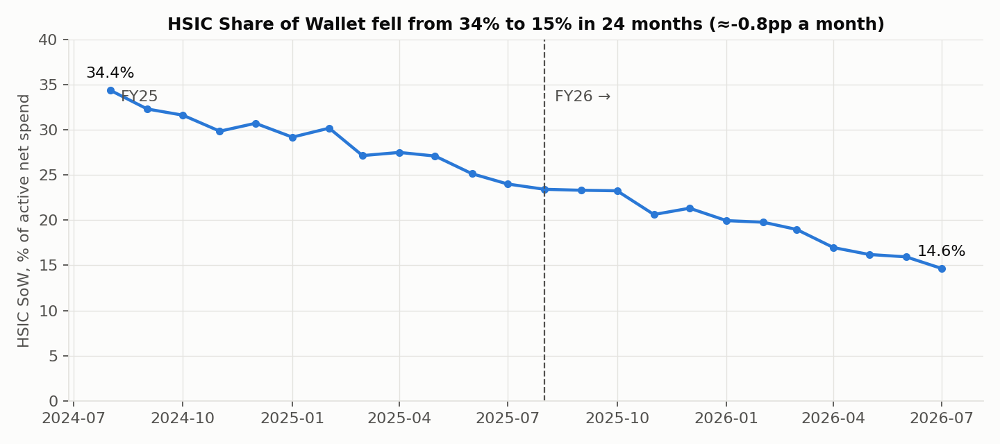

**SoW by fiscal half:**

| Half | SoW |
|---|---|
| FY25-H1 | 31.3% |
| FY25-H2 | 26.7% |
| FY26-H1 | 22.0% |
| FY26-H2 | 17.0% |

- **Active spend went up, not down.** Total active net rose from ₹29.6 crore to ₹35.4 crore, because more cards were open.
- Spend per active customer per month stayed flat at about ₹3,000–3,250.
- So customers are not shopping less at MetroMart. **They are paying less with HSIC.**

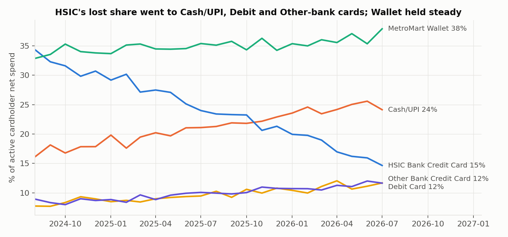

**Change in share of active cardholder spend, FY25 → FY26:**

| Method | Change |
|---|---|
| HSIC | −9.4pp |
| Cash/UPI | +4.5pp |
| Debit | +1.9pp |
| Other-bank credit card | +1.7pp |
| MetroMart Wallet | +1.3pp |

**Benchmark: customers without a card** (`tables/02_mix_by_fy.csv`) show the same direction of change:

| Method | Change |
|---|---|
| Cash/UPI | +1.8pp |
| Other-bank credit card | +1.4pp |
| Debit | +0.7pp |
| Wallet | −4.0pp |

This points to a market-wide move towards UPI and debit, not a problem specific to HSIC.

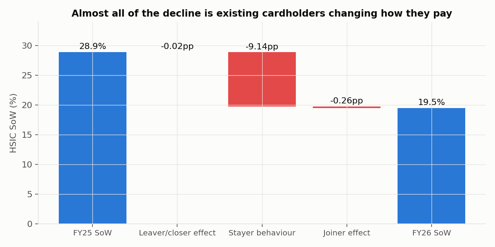

**SoW Bridge (exact, reconciled by an assert):**

| Step | Value |
|---|---|
| FY25 SoW | 28.91% |
| Leaver/closer effect | −0.02pp |
| **Stayer behaviour** (20,779 customers active in both years) | **−9.14pp** |
| Joiner effect | −0.26pp |
| FY26 SoW | 19.48% |

Among stayers, the 9.14pp went to:

| Destination | Share gained |
|---|---|
| Cash/UPI | +4.20pp |
| Debit | +1.86pp |
| Other-bank credit card | +1.83pp |
| Wallet | +1.24pp |

---

## 3. Is the decline concentrated anywhere?

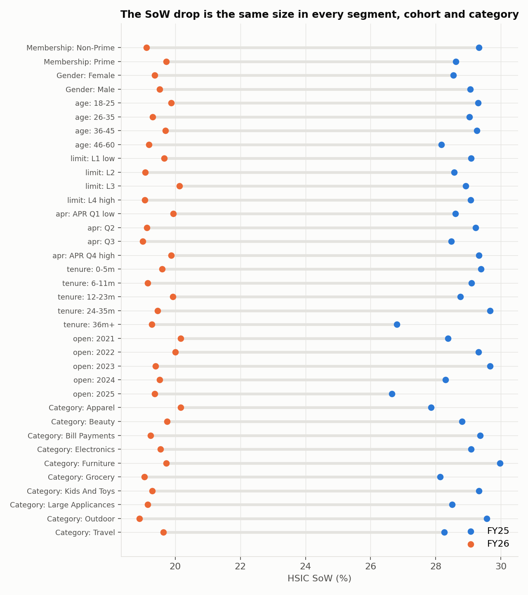

**No, it is not.**
- Every level of every attribute falls by **7.3–10.7pp** (`tables/03_sow_by_attribute.csv`).
- Categories, Prime status, age, credit limit, APR, card tenure and open cohort all decline in parallel.
- There is **no onboarding cliff**: HSIC share by months since opening tracks the portfolio rate month by month.

---

## 4. Signal vs noise: is HSIC usage a customer trait?

This test decides what kind of segmentation is valid.

| Test | Result | Meaning |
|---|---|---|
| Overdispersion of each payment method across customers vs the monthly portfolio rate (18,070 full-window cardholders) | **1.00–1.03** for all 5 methods | Customers vary no more than coin flips would. There is no "HSIC-loyal" or "cash-loyal" type. |
| Correlation of customer SoW, FY25 vs FY26 | **r = −0.001** | Last year's SoW predicts nothing. |
| Empirical-Bayes reliability of a customer's FY26 SoW | **0.007** | 99% of the observed variation is noise. |
| Persistence of other behaviours (r, FY25 vs FY26) | Visits **0.46** · Spend **0.24** · Grocery share −0.003 · Avg ticket 0.013 | **Frequency and value are traits.** Payment method, category mix and ticket size are not. |

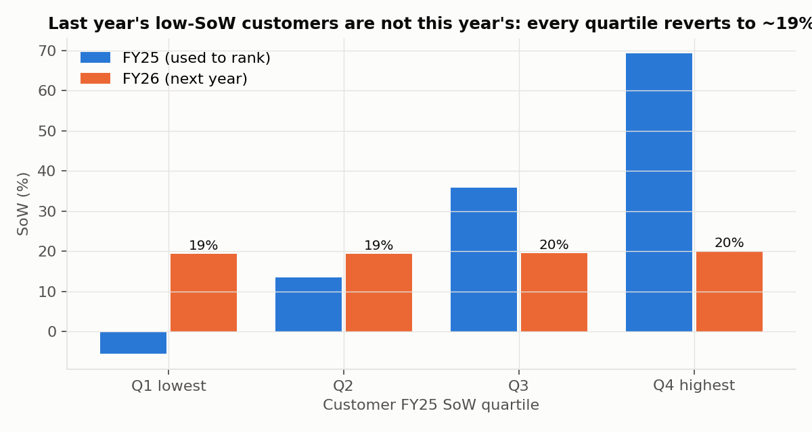

Customers ranked by FY25 SoW:
- The **lowest quartile** went from −5.5% to **19.4%**. It is negative because some customers' HSIC rows were mostly returns.
- The **highest quartile** went from 69.3% to **20.0%**.

**Targeting on past SoW gives no lift.**

---

## 5. Silent attrition

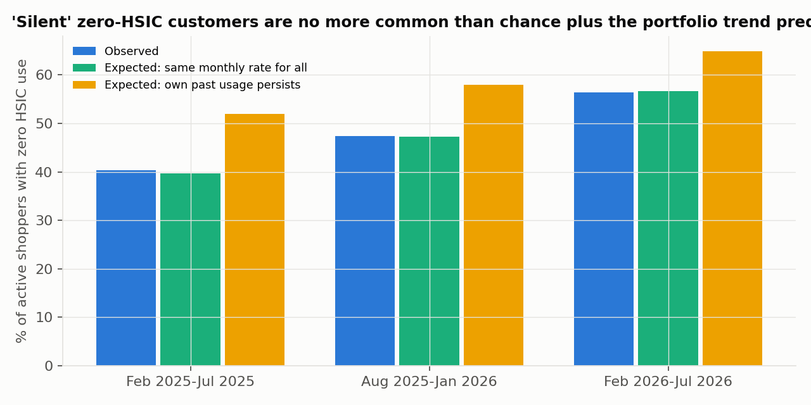

Population: open cards that were active across the history and evaluation windows, with at least 2 evaluation rows.

| Window | Customers | Observed zero-HSIC | Expected: same monthly rate for all | Excess |
|---|---|---|---|---|
| Feb–Jul 2025 | 11,349 | 40.3% | 39.6% (±0.4) | +0.7pp |
| Aug 2025–Jan 2026 | 13,042 | 47.4% | 47.2% | +0.2pp |
| Feb–Jul 2026 | 14,118 | 56.4% | 56.6% | −0.3pp |

- The zero-HSIC rate rose from 40% to 56%. **All of that rise is explained by the portfolio-wide fall in the monthly HSIC rate.** None of it comes from individual customers switching off.
- A null model that holds each customer's own history fixed confuses the trend with attrition. Avoid it, and re-check PROJECT_PLAN #21 with this in mind.
- **Testing customers one at a time** gives the same answer:
  - 6,882 open-card customers have enough rows to test.
  - 147 of them used HSIC zero times, against **156 expected by chance**.
  - So no group of customers is provably "silent".

**Implication:** silent attrition here means *the whole book quietly moving its MetroMart spend off HSIC*. A per-customer silent-attrition alert would mostly flag random customers.

---

## 6. Explicit attrition: card closures

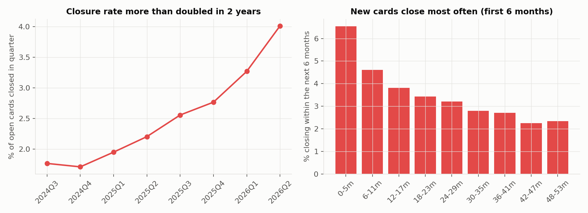

**Quarterly closure rate** rose from **1.77% (Jul–Sep 2024) to 4.01% (Apr–Jun 2026)**. That is 2.3× in two years, even as the open-card base grew from 20.3k to 29.8k.

**By tenure:**

| Tenure | Closing in the next 6 months |
|---|---|
| 0–6 months | 6.5% |
| 24–30 months | 3.2% |

- About 20% of cards have closed overall, the same across Prime status, gender and age band.

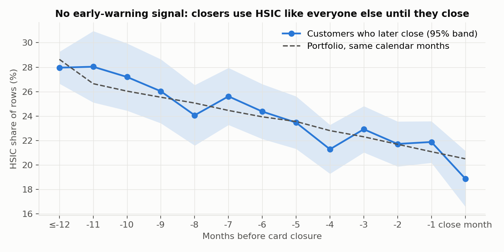

- **There is no early warning.** In each of the 12 months before closing, closers use HSIC at the portfolio rate for that month, within sampling error.
- **Closers keep shopping.** Visit rate before closure was 0.409 rows a month and after closure 0.409, against 0.411 for all customers.
  - **6,227 of 7,664** closers have transactions after their closure date.
  - Their FY26 post-closure spend was **₹6.07 crore**: Wallet 45.8%, Cash/UPI 28.1%, Debit 13.0%, Other card 13.1%.

**Closure prediction** (train on the 2025-07-31 snapshot, test on 2026-01-31; test base rate 6.2%):

| Model | Test AUC | PR-AUC | Top-decile lift |
|---|---|---|---|
| Tenure only (logistic regression) | **0.672** | **0.125** | **2.55×** |
| Behaviour only (recency, frequency, HSIC share) | 0.581 | 0.088 | 1.77× |
| All features (logistic regression) | 0.668 | 0.114 | 2.44× |
| All features (gradient boosting) | 0.656 | 0.110 | 2.34× |

**Tenure is the only useful predictor.** Behaviour adds nothing, which matches the finding of no pre-closure decay.

---

## 7. Rewards

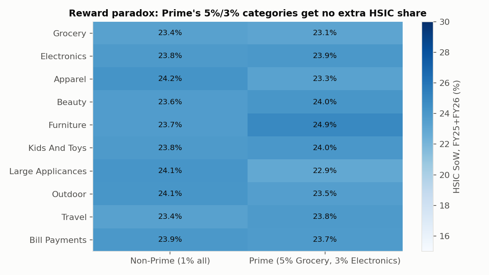

- **Reward paradox.** Every Prime × category cell sits at about 23–25% SoW. A difference-in-differences test asks whether Prime's (Grocery+Electronics − others) gap is bigger than Non-Prime's. Result: **+0.10pp, 95% CI −1.11 to +1.36** (bootstrap over customers).
  - A reward 3–5× richer produces no visible change in usage.
  - Caveat: Prime status is not randomly assigned, so this is a natural comparison, not an experiment.
- **No reinforcement from next-cycle credit.** Across 71,621 consecutive customer-month pairs, the month after a reward was credited shows **+0.19pp** more HSIC use than after a month with no reward, adjusted for calendar month. That is effectively zero.
- **Rewards paid** fell from ₹11.9 lakh (FY25) to ₹9.6 lakh (FY26).
- **Cashback customers gave up in FY26** by not using HSIC: **₹39.8 lakh**.
  - Prime Grocery + Electronics alone accounts for **₹16.0 lakh**, of which Electronics is ₹11.5 lakh (`tables/07_forgone_cashback_fy26.csv`).
  - Grocery is only **5.4%** of active spend. Electronics (22.5%), Large Appliances (17.5%) and Furniture (15.4%) dominate.

---

## 8. Ticket size and payment method

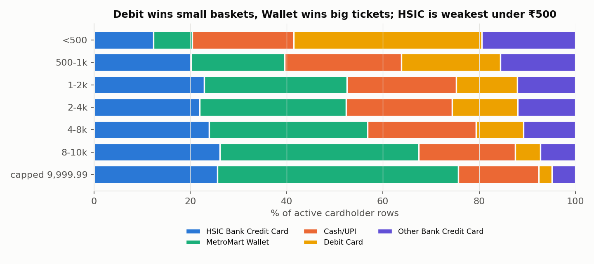

**Under ₹500:**
- Debit takes **39%** of rows and HSIC only **12%**.
- These baskets are small in value, about ₹21 lakh in FY26, so they are a low priority.

**Capped tickets (₹9,999.99):**
- MetroMart Wallet takes **50%** and HSIC 26%.
- Tickets of ₹8k and above made up **₹9.2 crore** of FY26 active spend, of which ₹7.2 crore was off HSIC.
- The big-ticket categories (Electronics, Furniture, Large Appliances) are ₹19.6 crore (56%) of FY26 active spend, and **₹6.8 crore of that is paid by Wallet**.

The ₹9,999.99 cap understates big-ticket values. This is disclosed, not corrected.

---

## 9. Customer-level SoW and segmentation

**Customer file:** `outputs/eda/customer_sow_segments.csv`, one row per customer (45,000). It contains:
- FY25 and FY26 active net, HSIC net and SoW;
- trailing-12-month SoW;
- segment, value tier, current SoW state and declining flag;
- chance of zero HSIC under the null model;
- forgone cashback;
- shrunk SoW.

### Method
- **The final segmentation is rule-based** on traits that persist: card lifecycle, tenure and spend tier. Current SoW is used only as a *state*, which tells us where the money is now.
- **K-means was tested and rejected.**
  - The best silhouette score is only 0.22, at k = 3.
  - Its clusters simply rediscover Prime vs Non-Prime and customers with negative net spend.
  - Every cluster's forward SoW falls between 16.8% and 17.4% (`tables/10_kmeans_clusters_backtest.csv`).

### Segments as of 31 Jul 2026 (`tables/10_segment_summary_2026-07-31.csv`)

Non-HSIC spend and SoW are over the trailing 12 months.

| Segment | Customers | Non-HSIC spend | SoW | Business meaning |
|---|---|---|---|---|
| Engaged core (SoW ≥ 15%) | 9,155 | ₹8.67 cr | 41.0% | Protect. No paid incentive, only reward-value messaging. |
| **High-potential low-SoW** (mid/high spend, SoW < 15%) | **9,877** | **₹16.06 cr** | 2.1% | **Largest pool of spend to win.** |
| Low-value low-SoW | 4,736 | ₹1.02 cr | n/m | Low priority, digital-only nudges. |
| Dormant (card open, no visits in 6 months) | 3,590 | ₹1.22 cr | 21.7% | Re-engage with MetroMart first. |
| New card (< 6 months) | 3,161 | ₹3.74 cr | 16.1% | **Closure risk: onboarding.** |
| **Closed – still shopping** | **6,133** | ₹7.46 cr (₹6.07 cr post-close) | — | **Win-back.** |
| Closed – gone | 1,386 | ₹1.03 cr | — | Not targeted. |
| No card (acquisition pool) | 6,962 | ₹8.34 cr | — | Out of SoW scope: acquisition only. |

In the Low-value low-SoW row, "n/m" means not meaningful: net HSIC is negative because of returns.

**Spend concentration:** the high-value tier holds **65.8%** of open-card non-HSIC spend (`tables/10_value_tier_concentration.csv`).

### Backtest: segments assigned at 31 Jan 2026, outcomes for Feb–Jul 2026

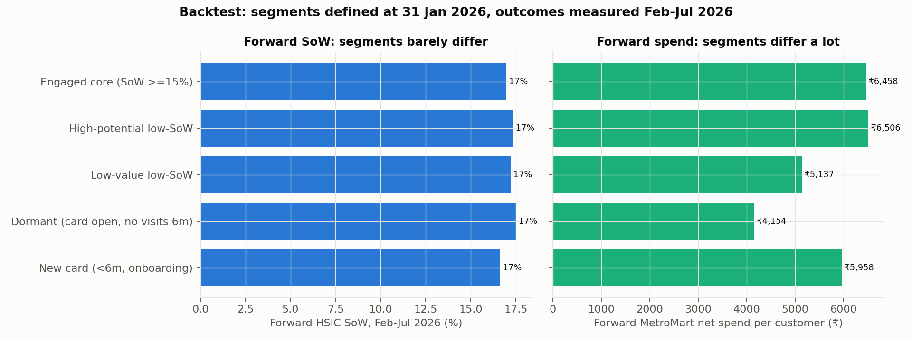

| Label | Forward SoW | Forward spend per customer | Forward closure |
|---|---|---|---|
| Engaged core | 17.0% | ₹6,458 | 4.7% |
| High-potential low-SoW | 17.3% | ₹6,506 | 4.7% |
| Low-value low-SoW | 17.2% | ₹5,137 | 5.7% |
| Dormant | 17.5% | ₹4,154 | 5.1% |
| **New card** | 16.6% | ₹5,958 | **14.7%** |
| Value tier: Low / Mid / High | 17.3 / 17.1 / 17.1% | **₹5,172 / ₹5,807 / ₹7,369** | — |
| SoW state: engaged / low / zero-HSIC | 17.0 / 16.6 / 17.4% | ₹6,590 / ₹7,022 / ₹5,847 | — |
| "Declining" flag: yes / no | 17.6 / 17.0% | — | — |

**How to read this:**
- Segments **do** separate on future spend (1.4× from low to high value tier) and on closure risk (3× for new cards).
- They **do not** separate on future SoW.
- So **"low-SoW" identifies where non-HSIC spend sits right now**. It is a valid targeting pool, but it is not a type of customer.
- Size uplift on spend, and measure it against a randomised holdout. Do not measure it as "low-SoW customers reverting", because they would revert on their own.

---

## 10. Insight → feature mapping

All ₹ figures are **Measured** unless marked otherwise. One point of SoW is worth **₹35.4 lakh of HSIC spend a year** (FY26 active net is ₹35.4 crore).

### F1 · Value-weighted Next-Best-Offer with built-in holdouts
- **Evidence:**
  - Customer SoW does not persist (r ≈ 0; reliability 0.007).
  - Spend and visits do persist (r = 0.24 and 0.46).
  - The high-value tier holds 65.8% of non-HSIC spend.
  - Forward spend is ₹7,369 for high value vs ₹5,172 for low.
- **Segment:** High-potential low-SoW (9,877 customers, ₹16.1 crore non-HSIC spend).
- **Problem:** targeting on "low SoW" alone mostly picks customers who were just unlucky, and their reversion looks like campaign success.
- **Feature:** rank eligibility by expected MetroMart spend × headroom. Hold out a randomised 10% in each segment. Report lift against the holdout, never as before/after.
- **Why it raises SoW:** it puts offer money where each converted point is worth the most, and makes the effect measurable.
- **KPI:** SoW and HSIC ₹ against the holdout; cost per incremental ₹.
- **Confidence:** high in the targeting logic; response is unknown (no offer data exists).

### F2 · Closed-card win-back
- **Evidence:**
  - 6,227 of 7,664 closers still shop, at an unchanged visit rate.
  - Their FY26 post-closure spend was ₹6.07 crore, 0% on HSIC.
  - Before closing, they used HSIC like everyone else.
- **Segment:** Closed – still shopping (6,133 active in the last 12 months).
- **Problem:** they left the card, not the store.
- **Feature:** a pre-approved, one-tap reopen (with a known KYC/credit history), a first-month Electronics/Grocery bonus, and an at-checkout prompt.
- **Impact (Simulated):** every 10% reactivated at the current ~17% SoW ≈ ₹10 lakh of HSIC spend a year.
- **KPI:** reopen rate and 90-day HSIC SoW of reopened accounts.
- **Confidence:** high on size, unknown on response.
- **Limitation:** the data does not say why they closed.

### F3 · First-6-months onboarding programme
- **Evidence:**
  - The first-6-month closure rate is 6.5%, against 3.2% at 24–30 months.
  - In the backtest, new cards closed at 14.7% vs about 5%.
  - Tenure is the best closure predictor (AUC 0.67). Behaviour adds nothing.
  - The quarterly closure rate has risen 2.3×.
- **Segment:** New cards (3,161 at any time; about 1,900 opened per quarter).
- **Feature:** a 3-touch onboarding journey (activation, first MetroMart purchase, first reward shown) with a month-3 check-in.
- **KPI:** 6-month closure rate of new cards against a holdout.
- **Confidence:** high on the risk pattern, but the cause is unobserved.

### F4 · HSIC on UPI / scan-to-pay at MetroMart checkout
- **Evidence:**
  - Cash/UPI is the largest destination of lost share (46% of the stayer shift; ₹8.28 crore of FY26 active spend).
  - Non-cardholders show the same move, so it is market-wide.
  - Debit dominates small tickets.
- **Segment:** all active cardholders. The shift is uniform, so this is a product fix rather than a segment offer.
- **Feature:** link the HSIC card to UPI (RuPay-credit-on-UPI style) so customers can scan to pay at MetroMart, with rewards kept.
- **KPI:** HSIC share of transactions that would otherwise be Cash/UPI.
- **Confidence:** medium on *where* the spend went, low on *why*.
- **Limitation:** Cash and UPI are combined in one payment code.

### F5 · Reward salience, not reward rate
- **Evidence:**
  - Prime's richer rates bring +0.1pp SoW (CI −1.1 to +1.4).
  - Next-cycle credit shows no reinforcement (+0.19pp).
  - ₹39.8 lakh of cashback was left unclaimed in FY26.
- **Feature:**
  - show at the till the cashback the customer would have earned ("You'd earn ₹X with HSIC");
  - test **instant cashback vs next-cycle credit** in an A/B test;
  - send a monthly "₹ you left on the table" message.
- **Explicitly not recommended:** blanket rate increases. The data's only rate contrast shows no response.
- **KPI:** SoW in test vs control.
- **Confidence:** high that rates are not working today; salience is an **untested hypothesis**.

### F6 · Big-ticket 0% EMI on HSIC (≥ ₹8k)
- **Evidence:**
  - MetroMart Wallet takes 50% of capped tickets.
  - ₹7.2 crore of FY26 tickets of ₹8k and above was paid off HSIC.
  - The brief lists financing as a card benefit.
- **Feature:** a 0% 3–6-month EMI on Electronics, Large Appliances and Furniture, shown at checkout.
- **KPI:** HSIC share of tickets ≥ ₹8k.
- **Confidence:** medium-low.
- **Limitations:** the amount cap; and Wallet belongs to MetroMart, so the partner may prefer Wallet.

### Not recommended (the evidence argues against them)
- Per-customer silent-attrition or "declining SoW" alerts: no signal above chance.
- Blanket cashback increases: no measured response to rates.
- Demographic or Prime-targeted SoW offers: the decline is identical everywhere.
- Small-basket (< ₹500) incentives: only ₹21 lakh of spend in FY26.

---

## 11. Prioritisation

Each feature is scored 1–5 on four axes. **Impact** is ₹ addressable; **Evidence** is the strength of the finding behind it.

| Rank | Feature | Impact | Feasibility | Evidence | Differentiation | Total |
|---|---|---|---|---|---|---|
| 1 | F1 Value-weighted NBO + holdouts | 5 | 5 | 5 | 3 | **18** |
| 2 | F2 Closed-card win-back | 4 | 4 | 4 | 3 | **15** |
| 3 | F3 New-card onboarding | 3 | 4 | 4 | 3 | **14** |
| 3 | F4 HSIC on UPI | 5 | 2 | 3 | 4 | **14** |
| 3 | F5 Reward salience / instant cashback | 3 | 4 | 3 | 4 | **14** |
| 6 | F6 Big-ticket EMI | 4 | 3 | 2 | 3 | **12** |

---

## 12. Assumptions & limitations

### Assumptions
- Amounts are in ₹.
- A Return reduces the method on its own row and claws back rewards. Returns are not linked to their original sale.
- Cards are active on both their open and close dates. Cards opened after the data ends are excluded.
- Prime status is a static snapshot.
- Rewards are derived, not observed.
- Travel and Bill Payments earn 1% for Prime.
- Value tiers are tertiles of all customers' trailing-12-month MetroMart net spend.
- "Low SoW" means a trailing-12-month SoW below 15%. "Declining" means a drop of at least 15pp between the last 6 months and the 12 before, with at least 2 rows on each side.

### Limitations
- **Synthetic-data signature.** Payment method, category and ticket size behave like independent draws per row, around a time trend. Results that depend on per-customer behaviour may not carry over to real portfolios. The pipeline is valid; this dataset's answer is "no individual signal".
- **No data** on channel (Cash vs UPI), offers, redemptions, interchange, credit events, or reasons for closure. Every response or uplift number is therefore **Simulated** until a pilot runs.
- The ₹9,999.99 cap understates big-ticket spend.
- Prime vs Non-Prime is observational, not randomised.

### Implications for PROJECT_PLAN hypotheses (for the team)

| Hypothesis | Verdict | Evidence |
|---|---|---|
| H1 | **Supported** | Stayers explain 97%. |
| H2 | **Supported** | Cash/UPI + Debit take 66% of the shift. |
| H3 | **Supported** | The gap is 0.1pp. |
| H4 | **Rejected** | No excess over the time-adjusted null, and no pre-closure decay. |
| H5 | **Likely rejected** | Behaviour adds no lift over the tenure rule. |
| H6 | **Expected to fail** | Reliability is 0.007. Report declines at segment level. |
| H7 | **Partly supported** | Segments separate on spend and closure, not on SoW. |
